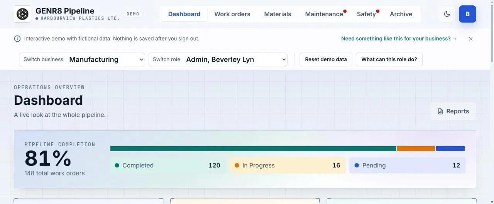

# GENR8 Pipeline: Showcase

**Live demo:** [pipeline-demo.solutions.genr83d.com](https://pipeline-demo.solutions.genr83d.com/). Pick a business and a role, then sign in with one click. All names, businesses and data are fictional.

> GENR8 Pipeline is a production-control product owned by [GENR8-3D](https://solutions.genr83d.com/). The source is private. This repository is a showcase, shared with GENR8-3D's permission. It contains no source code.

## What it is

An operations platform for tracking work orders, materials and consumables (with low-stock warnings), maintenance, and safety and hazards. It has three staff roles: admin, manager and staff. The demo covers seven businesses: manufacturing, auto repair, construction, warehousing, media production, logistics and catering.

## What I built

A backend-free interactive demo, shipped in **10 days (33 PRs)** with Claude Code:

- **Deterministic data engine:** generates a consistent year of completed and open work for each of the 7 businesses, with stock levels that match the replay of that history.
- **Invariant tests:** check the generated world for every day of a leap year.
- **Changes as an overlay:** a visitor's changes are replayed on top of the generated world. They survive a refresh, a role switch and a business switch, and are forgotten on sign-out or reset.
- **Guard rails:** custom ESLint rules (layer boundaries, a single clock, no `Math.random`), build-output guards with self-tests, and WCAG contrast checks for both themes.

## Stack

React · TypeScript · Vite · Tailwind CSS · Vitest · Playwright · Cloudflare Workers (static assets)
